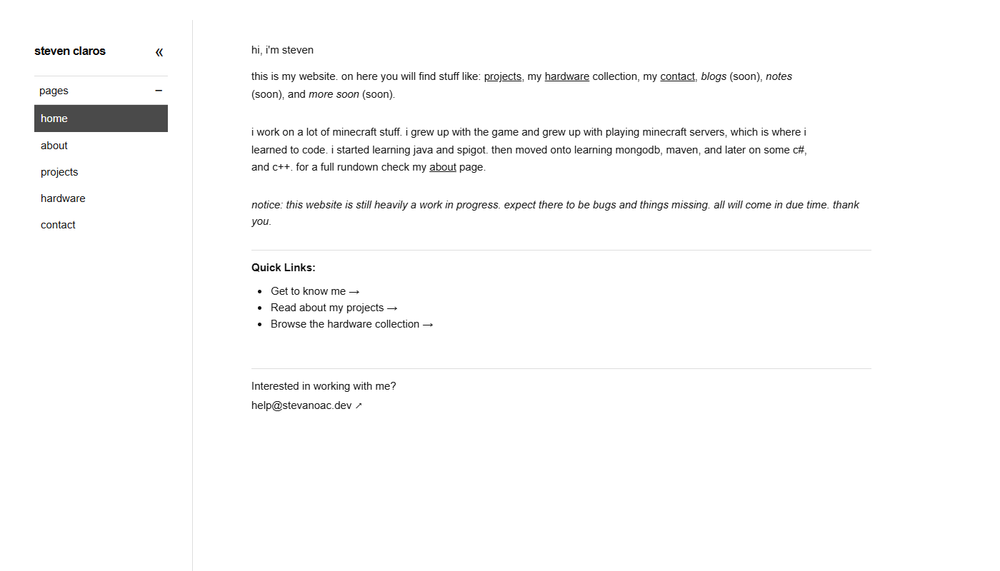

<h1 align="center">hello! i'm steven</h1>

  welcome to my github page! here you can find my public repositories and
  everything else you would normally find on a github page...

  

 

<h3 align="center">systems & backend</h3>

  for quite a while now i've been working on mainly minecraft and spigot projects. 
  a lot of that includes minigames, databases, apis, frameworks, and everything in between.
  if you're interested in seeing any of my projects consider checking out my website at
  <b>stevanoac.dev</b>. you can also find my contact on that website and below.

<h3 align="center">contact</h3>

  don't hesitate to contact me for any reason! 
  here is a list of where you can find me!  
  <b>discord</b>: stevanoac 
  <b>instagram</b>: stevanoac 
  <b>linkedin</b>: steven-claros 
  <b>email</b>: hello@stevanoac.dev 
  <b>site</b>: stevanoac.dev

<h3 align="center">languages and apps</h3>

  
  

    ps, check out: https://stevanoac.dev/

